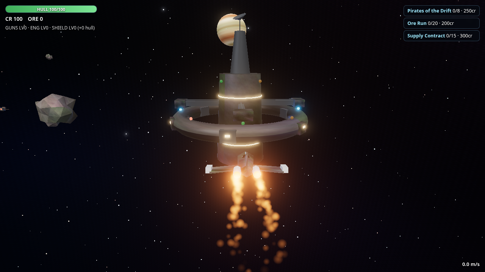

# KeelCode

A standalone game engine and framework built as a CLI-first workshop:
one framework spec, three working backends, and a command line that does
the talking. You scaffold a game, run it, test it, and smoke it from
`keel` — no visual editor until a shipped game needs one.



## What's here

- `framework/SPEC.md` — the v1 stack-neutral contract: fixed 60Hz
  timestep with named phases (`PreUpdate`/`Update`/`PostUpdate`/`Render`),
  seeded randomness as a recommended pattern, the canonical component
  set, perf budgets with a binding no-regression rule, asset
  conventions, and the save-format contract. The schemas in
  `framework/schema/` are the machine-checkable form.
- `backends/ts-three/` — the reference backend: TypeScript on three.js
  with Rapier physics, plus a demo game (arena shooter with enemies,
  save/load, HUD).
- `backends/rs-core/` — Rust: a headless sim core (archetype ECS,
  fixed-step loop, scripted input, checksum save format) held to strict
  parity against the reference backend's recorded vectors, plus a wgpu
  desktop renderer.
- `backends/ts-babylon/` — TypeScript on Babylon.js with Havok physics,
  behind the same engine boundary as the reference backend.
- `games/starfall-drift-arena/` — STARFALL: Drift Arena, the first real
  game built with the CLI: arcade space flight, pirate AI, asteroid
  mining, a station economy with upgrades and quests, and engine
  save/load. Built in one wave, then given a full graphics overhaul
  (ACES tone mapping, bloom, procedural nebula, instanced asteroid
  field, pooled particles).
- `tools/keel-cli/` — the `keel` CLI, the primary interface (see
  `docs/CLI.md`).
- `tools/asset-baker/` — bakes an asset folder into a
  schema-valid `asset-manifest.json` with per-file content hashes.
- `tools/pipeline/` — the wave build pipeline: a wave runner,
  parallel-builder templates, and a collaboration safe room with
  contract checks across backends.
- `docs/ADRs/` — the real decisions, one file each (ADR-0001 through
  ADR-0016).
- `docs/KB-MAP.md` — which knowledge-base note owns which subsystem.

No mandated art direction (ADR-0001): demos use neutral placeholder
art — clean geometry, good lighting, no house style.

Determinism is not required. Seeded RNG is a recommended pattern for
procedural stuff, but there is no byte-identical contract across
backends. Behavior is tested per backend against its own recorded
vectors — and the Rust core is held to measured tolerances against the
reference backend, not vibes (ADR-0007).

## Quickstart

```bash
# from the repo root
npm install -g ./tools/keel-cli   # or: node tools/keel-cli/bin/keel.mjs

keel new my-game                       # --backend ts-three (default),
                                       # ts-babylon, or rs-core
cd my-game && npm install
keel dev        # dev server (cargo projects: runs the headless bin)
keel build      # tsc --noEmit && vite build (cargo projects: cargo build)
keel test       # vitest (cargo projects: cargo test)
keel smoke      # shared smoke checks across all three backends
keel bake       # bake an asset folder into a manifest
keel perf       # perf harness against the budgets
```

To play Drift Arena:

```bash
cd games/starfall-drift-arena && npm install && npm run dev
```

WASD + mouse to fly, hold E at an asteroid to mine, F to dock.

## Gates (per wave, no exceptions)

- `tsc` clean, vitest green, Playwright e2e green, zero console errors
  in the demo run
- Perf budgets held; any regression is measured, disclosed, and
  explicitly waived — never waived quietly (binding rule, SPEC.md §4)
- Behavioral smoke tests pass against each backend's recorded vectors
- Report-first: each wave opens with a written brief; code starts on
  the user's word. A wave ends with something playable, not scaffolding.

## License

MIT — see `LICENSE`.
